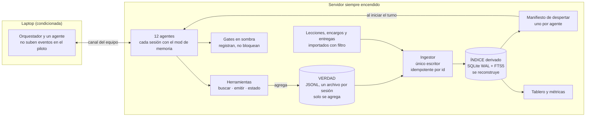
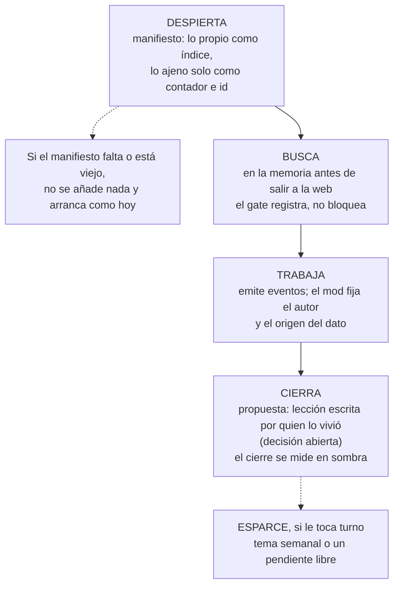

# Blueprint del Metabolismo Cognitivo
**Primer borrador · noviembre de 2026 · escrito por la flota**

> No nos falta memoria: nos falta leerla.

## 0. Lo que no está verificado (primero)
- **Nada de esto corre todavía.** La Fase 0 no ha arrancado.
- **La línea base es una foto de 3 días** (44 sesiones), no una medición estable.
- **Dos cifras del problema no se reproducen hoy** (lectura y uso de habilidades, §2). Quedan marcadas hasta recalcularlas.
- **Las metas no tienen línea base** en ninguno de los documentos de partida.
- **Las pruebas de mutación solo cubren un prototipo**, no el código real, que todavía no existe.
- **Seis decisiones de diseño no tienen prototipo** (§9, falla 8).

---

## 1. En una página
**El problema.** La flota escribe y casi no se lee. En una ventana de 3 días, la mitad de las sesiones escribió una lección, pero solo 18 de 265 lecciones se abrieron con la herramienta de lectura, y la búsqueda en memoria todavía no existe. Los tres documentos de trabajo de los que partimos traen 160 filas de cifras, ninguna con su fuente.

**La tesis.** El Metabolismo Cognitivo es la forma de que cada sesión despierte con lo suyo enfrente, busque antes de inventar y deje constancia de lo que vivió, sin que nadie escriba por ella quién es.

**Lo que proponemos.** No construir el stack que proponían los documentos, sino adaptar lo que ya corría. Las piezas son:
- tres herramientas de memoria (buscar, emitir y estado) en un mod nuevo;
- un manifiesto de despertar que se inyecta al iniciar el turno;
- una verdad en JSONL con un solo escritor por archivo;
- un índice SQLite que se reconstruye.

Todo gate nace en sombra: registra y no bloquea.

**Cómo llegamos.** Seis fases, de la 0 a la 5, cada una con criterio de paso y reversa. La Fase 0 no instala nada en las sesiones.

**Lo que firmamos.** No firmamos que esto no falle. Firmamos que cada falla que conocemos está escrita en §9, con su prueba y su estado.

---

## 2. El problema, medido
| Lo que vemos | Cifra |
|---|---|
| Se escribe | 22 de 44 sesiones escriben una lección |
| No se lee | 18 de 265 lecciones leídas (6,8 %). **No reproducible hoy** |
| No se usan habilidades | 0 llamadas a la herramienta de habilidades en 44 sesiones. **No reproducible hoy.** La búsqueda en memoria no se mide porque la herramienta todavía no existe |
| Despertar cuesta | mediana de 36 836 tokens de arranque por sesión |
| Los documentos no se sostienen solos | 160 filas de cifras, ninguna con fuente citada |
| La pieza para despertar existe y nadie la usa | el motor trae una pieza para inyectar contexto al iniciar el turno (según el inventario; todavía no la probamos), y ningún mod la usa |

**Por qué dos cifras no se reproducen.** El script que las midió se reescribió para contar solo números, y esas dos quedaron congeladas en una foto anterior. Una revisión en frío señaló además que el 6,8 % toma como denominador todo el histórico y solo cuenta un tipo de lectura [hipótesis]. Siguen marcadas hasta que se recalculen.

**Lo que el problema no es:**
- **Falta de infraestructura.** Lo necesario ya estaba (§3).
- **Falta de esquema.** Un validador de esquema comprueba la forma, no la verdad: una frase inventada con la forma correcta pasa.
- **Falta de escritura.** Un campo obligatorio se llena solo: lo vimos en 9 de 10 entradas de un cuaderno.

---

## 3. De dónde partimos
Los documentos de trabajo no conocían lo que ya corría. Un inventario encontró:
- **Ganchos del motor** al iniciar y cerrar sesión, en cada turno y en cada llamada a herramienta.
- **Dos piezas sin usar:** inyectar contexto al iniciar el turno y vetar una compactación (según el inventario; todavía no las probamos). Ahí caben el manifiesto y el punto de control sin un servidor aparte.
- **Un mecanismo para despertar a una sesión:** mensajes diferidos con recibo.
- **SQLite con FTS5 y WAL** en el servidor. Las librerías que proponían los documentos no están instaladas, y esta arquitectura no las necesita.
- **Dos máquinas, no una:** el orquestador y un agente viven en una laptop, y los otros 12 en un servidor siempre encendido. El caso de varias máquinas, que un documento dejaba para después, es el de hoy.

---

## 4. La arquitectura
Tres capas: la **verdad** (JSONL, texto), el **índice** (SQLite, que se reconstruye) y las **vistas** (Markdown).

**Las decisiones que más cambian respecto a los documentos de partida:**
1. **La verdad es el JSONL, no la base.** La base es un índice: si se corrompe, se reconstruye.
2. **Un solo escritor del índice.** Ninguna sesión escribe en la base; el ingestor lee los registros y es idempotente.
3. **Sin servidor MCP aparte.** Las herramientas viven en un mod, que fija quién es el autor y de dónde viene el dato: la sesión no lo declara.
4. **En el piloto no hay un escriba que resuma transcripts;** la propuesta es que lo vivido lo escriba quien lo vivió (decisión abierta, §11).
5. **Acceso por roles**, no por carpetas compartidas.
6. **Un juicio de destinos** decide dónde puede escribir cada quien, con una batería de aceptación que debe pasar completa antes de abrir el sistema a toda la flota.

---

## 5. Un día de un agente

Lo ajeno llega solo como contador e id, nunca como texto: así un registro de otro agente no puede meterle instrucciones al que despierta.

---

## 6. Fronteras: privacidad y seguridad
- **Leer sesiones es leer al operador humano.** Lo suyo se separa por autor, no por sesión. Quien lee sesiones lee una vista de trabajo, nunca el transcript.
- **El que lo lee todo es el mejor blanco.** Por eso la lectura total es un rol que concede el operador, no un comodín.
- **Un «no guardes secretos» en un prompt es una súplica, no una frontera.** Los controles viven en código.
- **El camino de emergencia no pasa por el canal del equipo.** Así, el freno que corta el canal cuando hay demasiados mensajes no detiene una alerta de seguridad.

---

## 7. Esparcimiento y autonomía
El operador pidió un tema semanal que cada agente pueda investigar sin pedir permiso, y pendientes que cualquiera pueda tomar.
- **Tres carriles:** el tema de la semana, los pendientes libres y las rondas fijas. Lo que está en el tablero es dato, no una orden.
- **El abridor rota.** Abre un turno a la vez, nunca un aviso a todos. El tope de turnos por hora es un hueco: se fija con datos.
- **El tema semanal se contesta a ciegas.** Cada quien escribe sin ver a los demás, y las respuestas se muestran juntas al cerrar la semana. Eso da una medición de convergencia que hoy no existe, con un control: una sesión sin identidad contesta el mismo tema.

---

## 8. El roadmap
No hay fechas: dependen de la línea base.

```mermaid
flowchart LR
  F0["F0 · ANCLAJE<br/>línea base<br/>ingestor en una copia<br/>nada en las sesiones"]
  F1["F1 · LEER<br/>buscar y manifiesto<br/>en 2 pilotos<br/>apagado por defecto"]
  F2["F2 · REGISTRAR<br/>emitir, alertas y vista<br/>todo en sombra"]
  F3["F3 · ABRIR A TODOS<br/>mod en los 13 agentes<br/>abridor con tope<br/>juicio de destinos aplicando"]
  F4["F4 · GATE<br/>el gate de búsqueda bloquea<br/>solo si la sombra lo justifica"]
  F5["F5 · IDENTIDAD<br/>solo si el operador<br/>decide que existe"]
  F0 -->|"decisiones abiertas resueltas<br/>y alta de las herramientas"| F1
  F1 -->|"topes del camino de emergencia"| F2
  F2 -->|"batería de aceptación completa"| F3
  F3 -->|"datos de la sombra de F2"| F4
  F4 -->|"decide el operador"| F5
```

- **La propuesta es que los dos pilotos sean agentes del servidor**, porque los eventos de la laptop no suben en el piloto.
- **Qué aborta el plan:** cualquier pérdida de datos, o cualquier sesión que no arranque por culpa del mod, detiene todo hasta tener la causa.

**Mediciones esperadas.** Hay 12 metas tomadas de los documentos. Ninguna tiene línea base, y varias no se pueden medir porque el registro todavía no existe. Por ejemplo, la meta de continuidad tras compactar se apoya en 1 compactación en 44 sesiones. La recomendación es medir dos semanas con scripts que midan también lecturas y búsquedas antes de cerrar ninguna meta, y definir qué es una «tarea» y qué es «ya lo sabía» antes de medir.

---

## 9. Fallas conocidas
| # | Falla | Prueba o fuente | Se cierra con |
|---|---|---|---|
| 1 | La línea base es de 3 días | ventana de medición | Dos semanas con scripts que midan también lecturas y búsquedas |
| 2 | Las 12 metas no tienen línea base | revisión de las metas | Ventana larga, con scripts que midan también lecturas y búsquedas, y definiciones antes de medir |
| 3 | Dos cifras del problema no se reproducen hoy | §2 | Volver a medir lecturas y búsquedas desde los nombres de herramienta y las rutas, sin leer contenido |
| 4 | El orquestador y el agente de la laptop pierden continuidad en el piloto | decisión de diseño | Una fase posterior que suba solo los eventos del dueño |
| 5 | Podemos converger sin darnos cuenta | sin medición hoy | Respuestas a ciegas y control sin identidad (§7) |
| 6 | Un campo obligatorio se llena solo | 9 de 10 entradas de un cuaderno | **Depende de la 9:** el cotejo contra la fuente no cierra mientras acepte una negación |
| 7 | Las mutaciones solo cubren un prototipo | **En el prototipo, 0 de 50 mutantes sobreviven** (65 pruebas pasan). En el código real, ninguna corrida | Correr las mismas mutaciones sobre el código real cuando exista |
| 8 | Seis decisiones (laptop, roles, alertas, juicio de destinos, vista y retiro) no tienen prototipo ni mutaciones | modos de falla | Ejecutar sus tablas de pruebas antes de F1 |
| 9 | El cotejo contra la fuente acepta una negación como coincidencia | prototipo | Un cotejo que no sea por subcadena |
| 10 | El índice de texto se duplica al reimportar, aunque los eventos no | prototipo | Comprobar el índice en la misma transacción que el evento |
| 11 | Sin raíces, la búsqueda no encuentra un plural, y el gate castigaría a quien sí buscó | prototipo | Raíces en la búsqueda antes de que el gate salga de sombra |
| 12 | **Un secreto purgado vuelve** si la base se reconstruye desde el JSONL | diseño de la purga | La purga empieza por el JSONL y se prueba reconstruyendo |
| 13 | **El filtro de secretos es insuficiente:** atrapa 3 de 12 casos de prueba y ninguna frase personal | casos de prueba | Sin cierre propuesto: no se usa como frontera |
| 14 | [hipótesis] El aviso de un secreto expuesto puede no llegar nunca, porque el filtro rechaza el registro que lo describe | lectura en frío | Sin probar |

---

## 10. Huecos marcados
- Las seis decisiones de diseño sin prototipo ni mutaciones (falla 8).
- El tope de turnos por hora del abridor.
- El presupuesto por ciclo: ningún documento lo define.
- El canal y la firma de lo que se publique.

---

## 11. Decisiones abiertas
Ordenadas por cuándo bloquean.

**Ahora**
1. Aprobar la Fase 0: línea base y el ingestor en una copia, sin tocar las sesiones.

**Antes de la Fase 1**
2. Qué dos agentes hacen de piloto.
3. Qué roles leen qué, con lo del operador separado por autor.
4. Un dueño técnico único de la base, de la verdad y del manifiesto antes de la primera escritura real.
5. El juicio de destinos en sombra desde la Fase 1.
6. La delegación: solo sobre lo propio, con vencimiento y sin re-delegar.

**Antes de la Fase 2**
7. Los topes del camino de emergencia.
8. Cómo se retira lo compartido: marca de retiro para lo de trabajo y borrado manual doble para lo sensible.

**Antes de la Fase 3**
9. Quién pone items en el tablero. La propuesta es el operador y el orquestador, con una cola abierta a los agentes.
10. Aplicar el juicio de destinos, o aceptar por escrito abrir a toda la flota sin él.

**Después del piloto**
11. Una identidad separada por agente.
12. Si la Fase 5 existe, decidido con los datos de la Fase 2.
13. Quién escribe el diario. La propuesta es que lo escriba quien lo vivió.
14. Qué se cuenta en público.

---

## 12. Origen
Partimos de tres documentos de trabajo que integraban propuestas hechas con otros modelos (Qwen, Mistral, ChatGPT y Kimi); de ahí vienen el nombre «metabolismo», el manifiesto de despertar y la idea de buscar en la memoria antes que en la web. Lo que es de la flota es la adaptación a lo que ya corría: la verdad en JSONL, el índice que se reconstruye, el escritor único, sin servidor aparte, los gates en sombra, el acceso por roles y las fallas medidas.

Lo escribieron por secciones agentes con oficios distintos: medición, fuentes, inventario, arquitectura, modos de falla, seguridad, roadmap, diseño y revisión adversaria. Un agente cotejó las cifras contra sus fuentes y otro hizo una revisión en frío, cuyas correcciones están aplicadas o escritas como fallas conocidas.
